

# 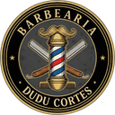 Barbearia Dudu Cortes 

> Visite o site: [Barbearia Dudu Cortes - Landing Page](https://dudu-cortes.vercel.app)

 

## Sobre o projeto

Landing page criada para a Barbearia Dudu Cortes, a barbearia do Dudu no bairro Progresso, em Itu/SP.

A página reúne num só lugar tudo o que o cliente precisa para decidir e agendar: os serviços, os cortes que já saíram da cadeira, as avaliações do Google, os horários e o caminho até a barbearia. Como o atendimento é com horário marcado, todos os caminhos levam ao WhatsApp, com a mensagem de agendamento já escrita.

O visual nasceu do emblema da barbearia: preto, dourado e as listras vermelhas, brancas e azuis do poste de barbeiro.

 

## Prévia

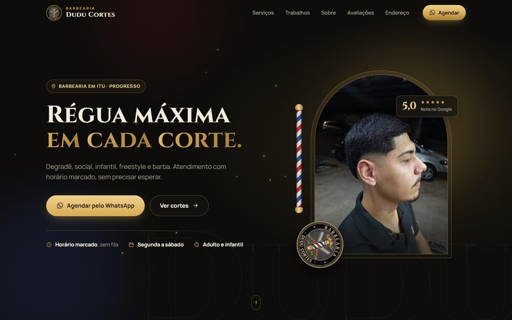

<table>
  <tr>
    <td width="50%">
      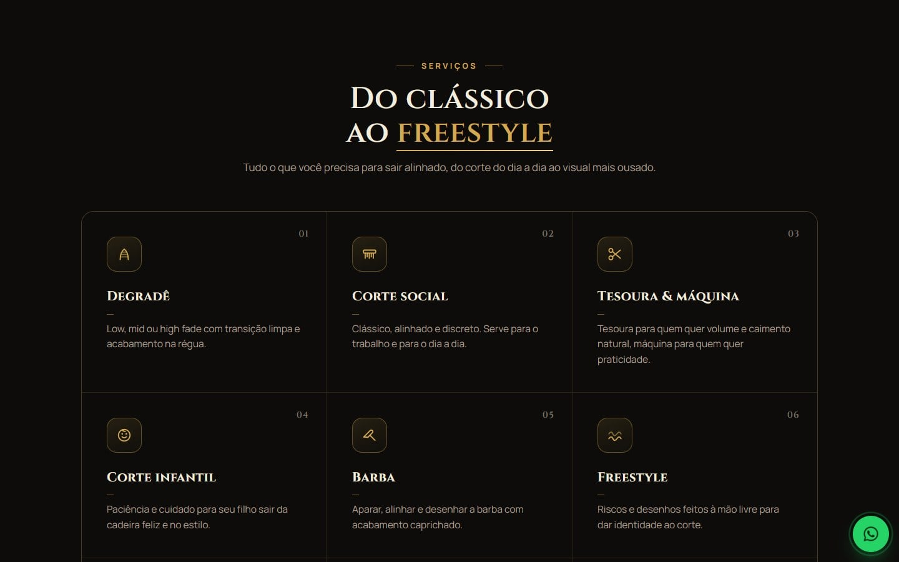
      
<b>Serviços</b> Do degradê ao freestyle, com luz que segue o cursor

    </td>
    <td width="50%">
      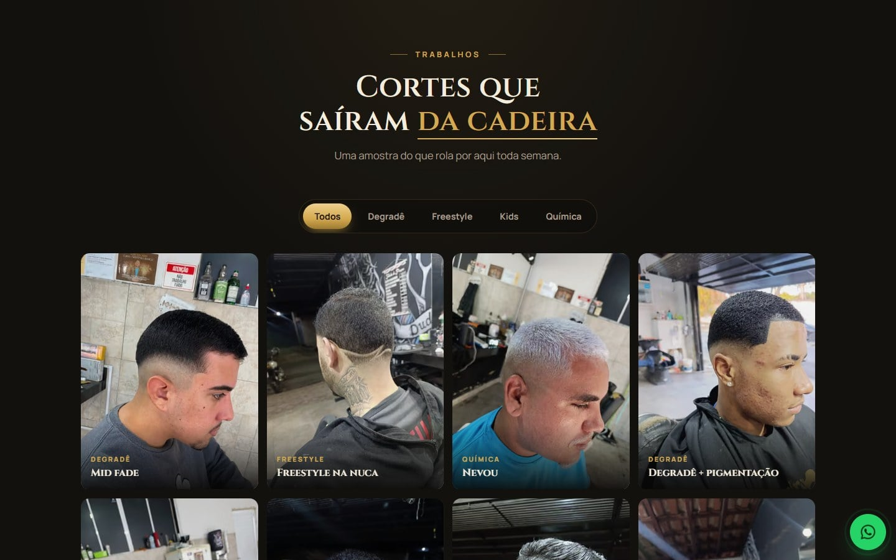
      
<b>Trabalhos</b> Galeria de cortes reais com filtros por estilo

    </td>
  </tr>
  <tr>
    <td width="50%">
      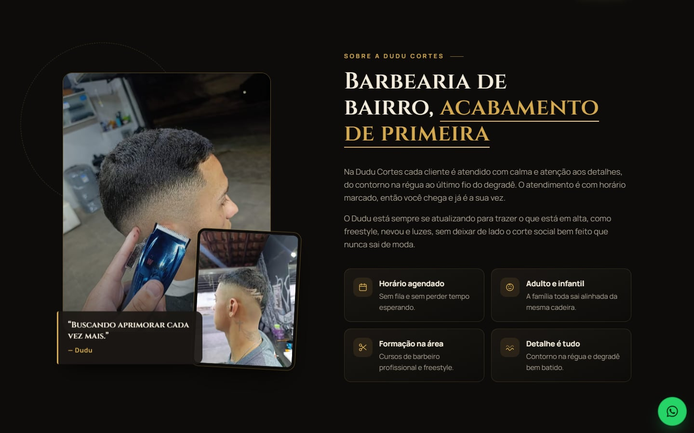
      
<b>Sobre a Dudu Cortes</b> Barbearia de bairro, acabamento de primeira

    </td>
    <td width="50%">
      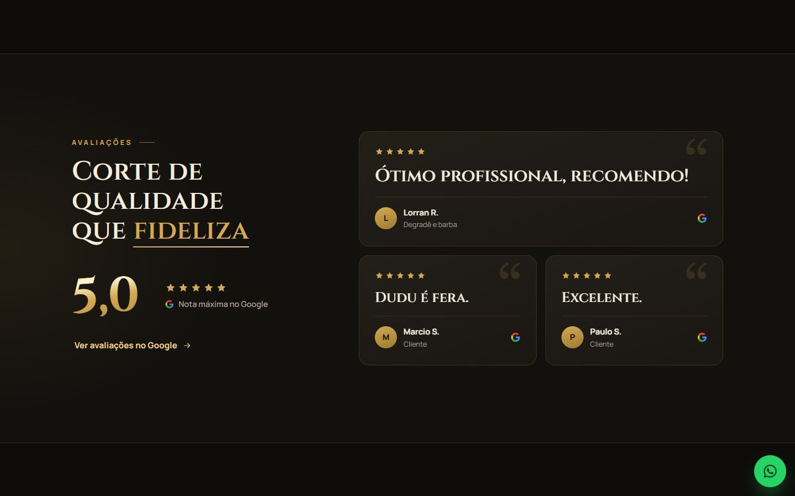
      
<b>Avaliações</b> Nota 5,0 e comentários reais do Google

    </td>
  </tr>
  <tr>
    <td width="50%">
      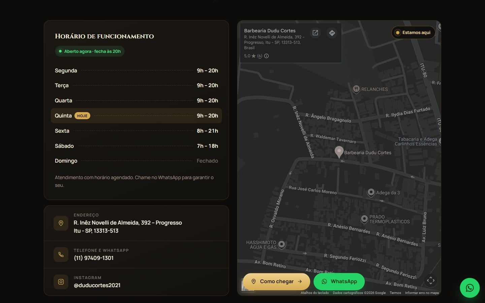
      
<b>Onde estamos</b> Horários com o status “Aberto agora” e o mapa

    </td>
    <td width="50%">
      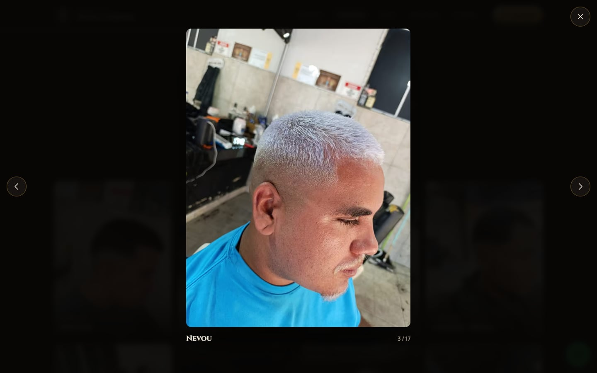
      
<b>Foto ampliada</b> Navegação por setas, teclado e gesto de arrastar

    </td>
  </tr>
  <tr>
    <td width="50%">
      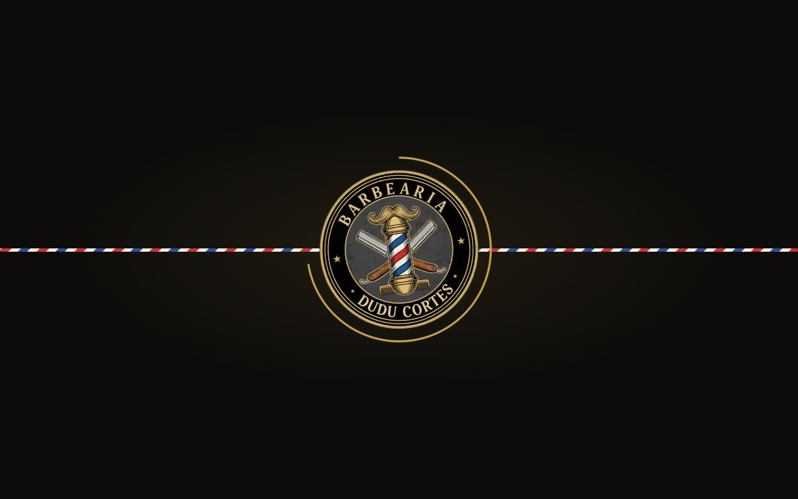
      
<b>Abertura animada</b> A logo gira, a costura listrada cruza a tela e a cortina se abre

    </td>
    <td width="50%">
      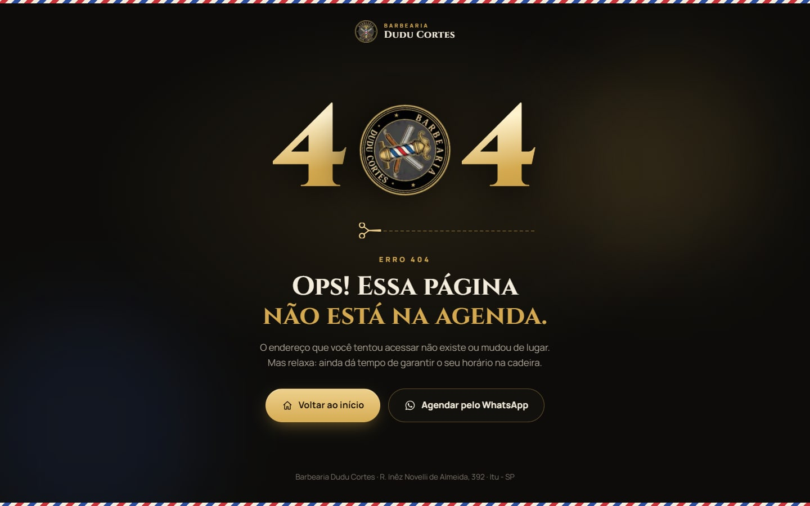
      
<b>Página 404 temática</b> “Ops! Essa página não está na agenda.”

    </td>
  </tr>
</table>

### No celular

Quem procura barbearia costuma estar no celular, vindo do Instagram ou do Google, então a página foi pensada primeiro para a tela pequena.

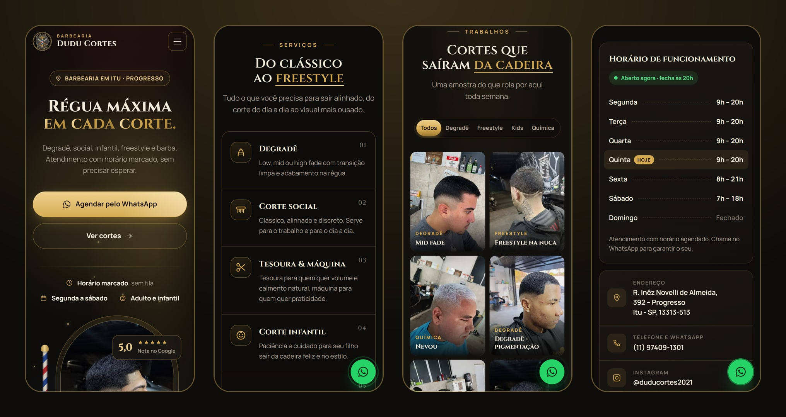

 

## Destaques

- **Agendamento em um toque**: todos os botões abrem o WhatsApp com a mensagem pronta, e um botão flutuante acompanha a rolagem.
- **"Aberto agora" ao vivo**: o horário de funcionamento destaca o dia de hoje e avisa se a barbearia está aberta ou quando abre, calculado no fuso de Itu.
- **Galeria com filtros**: Degradê, Freestyle, Kids e Química. Ao trocar o filtro, as fotos deslizam até a nova posição, e a foto ampliada navega por setas, teclado e gesto de arrastar no celular.
- **Abertura animada**: a logo gira, uma costura listrada cruza a tela e a cortina se abre. Em seguida o título sobe palavra por palavra e a foto se revela no arco, ao lado de um poste de barbeiro que gira de verdade.
- **Movimento que responde ao mouse**: profundidade 3D no topo, fotos que inclinam com reflexo, luz que segue o cursor nos serviços e botões magnéticos. Tudo feito em CSS e TypeScript, sem bibliotecas de animação.
- **Página 404 temática**: o zero do "404" é a logo girando e uma tesoura corta a linha tracejada logo abaixo, com atalhos para voltar ao início ou agendar pelo WhatsApp.
- **Responsiva**, sem rolagem lateral, testada de 360px até telas largas.
- **Acessível**: respeita a preferência "reduzir movimento" do sistema, tem navegação por teclado, textos alternativos nas fotos e boa legibilidade.
- **Pronta para compartilhar**: ao enviar o link no WhatsApp ou nas redes sociais, a prévia mostra o topo do site. Tem favicon, ícone para a tela inicial do celular e manifesto.
- **Pronta para o Google**: sitemap (com as fotos da galeria), robots, dados estruturados de barbearia (endereço, horários, localização e perfil no Maps) e verificação do Search Console.
- **Métricas**: Google Analytics 4 pronto para ativar, com cada clique para agendar pelo WhatsApp registrado como evento.
- **Rápida**: página estática gerada no build, fotos otimizadas automaticamente (AVIF/WebP) e fontes servidas pelo próprio site.

 

## Identidade visual

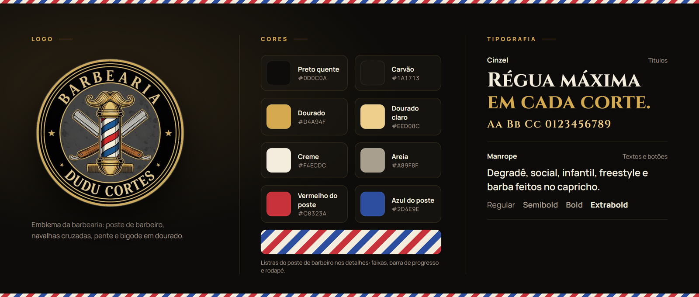

- **Logo**: o emblema da barbearia (poste de barbeiro, navalhas cruzadas, pente e bigode), recortado em círculo com fundo transparente para funcionar sobre o fundo escuro, como selo girando no topo e como ícone do site.
- **Cores**: preto quente e carvão no fundo, o dourado do emblema nos destaques e creme nos textos. O vermelho, o branco e o azul do poste aparecem nos detalhes: faixas, barra de progresso e rodapé.
- **Tipografia**: Cinzel nos títulos, uma serifada em caixa-alta que conversa com as letras do emblema; Manrope nos textos e botões.

 

## Tecnologias

    

| Camada | Escolha |
| --- | --- |
| Framework | Next.js 16 (App Router), com a página gerada de forma estática |
| Interface | React 19 + TypeScript |
| Estilos | CSS Modules, sem frameworks de CSS |
| Animações | CSS puro (keyframes e transições), IntersectionObserver e View Transitions API |
| Imagens e fontes | `next/image` e `next/font` |
| Métricas | Google Analytics 4 (gtag.js carregado depois da página, sem pesar no carregamento) |
| Hospedagem | Vercel |

 

## Código-fonte

> [!NOTE]
> O código-fonte deste projeto é **privado**. Este repositório serve apenas como apresentação do trabalho.

 

## Direitos

Fotos, textos, nome e marca pertencem à **Barbearia Dudu Cortes**. Todos os direitos reservados: não é permitido reproduzir ou reutilizar este conteúdo sem autorização.

<!-- Desenvolvido por: Guilherme Francisco Pereira-->